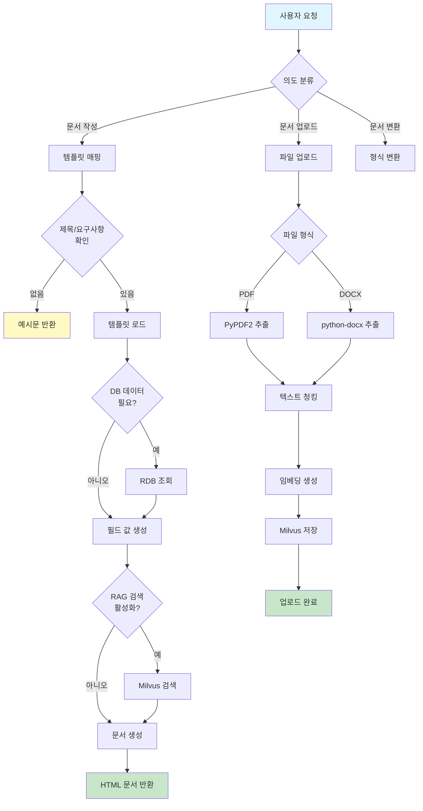

# 프로젝트 수행 경과 - 문서 AGENT

## 활용된 기술

### 1. **LangGraph**
- **용도**: 워크플로우 관리 및 상태 기반 라우팅
- **기능**: 
  - 문서 작업 유형 분류 (작성/업로드/변환)
  - 템플릿 매핑 및 라우팅
  - 상태 기반 그래프 실행

### 2. **Milvus**
- **용도**: 벡터 데이터베이스 (RAG용)
- **기능**:
  - 문서 임베딩 벡터 저장
  - 키워드별 컬렉션 분리
  - 유사 문서 검색

### 3. **OpenAI API**
- **용도**: 
  - 의도 분류 (Intent Classification)
  - 템플릿 필드 값 생성
  - 문서 초안 생성 (LLM)
  - RAG 답변 생성

### 4. **Sentence Transformers**
- **용도**: 임베딩 생성
- **모델**: `paraphrase-multilingual-MiniLM-L12-v2`
- **기능**: 한국어 지원 다국어 임베딩 생성 (384차원)

### 5. **PyPDF2**
- **용도**: PDF 텍스트 추출
- **기능**: PDF 파일에서 텍스트 데이터 추출

### 6. **python-docx**
- **용도**: Word 문서 텍스트 추출
- **기능**: DOCX 파일에서 텍스트 데이터 추출

### 7. **Redis**
- **용도**: 멀티턴 대화 컨텍스트 관리
- **기능**:
  - 세션별 대화 히스토리 저장
  - 문서 생성 컨텍스트 유지
  - 이전 요청 정보 복원

### 8. **RDB (PostgreSQL/MySQL)**
- **용도**: 구조화된 데이터 조회
- **기능**:
  - 템플릿별 필드 데이터 매핑
  - 동적 쿼리 생성 (LLM 기반)
  - 데이터 바인딩

## 피드백 내용 및 적용 내용

### 문제 1: 문서 업로드 시 디스크 공간 부족
- **문제**: PDF 파일을 매번 디스크에 저장하여 벡터화 처리 시 디스크 공간 부족 발생
- **적용**: 메모리 기반 PDF 처리로 전환
- **결과**: 디스크 공간 절약 및 처리 속도 개선

### 문제 2: 스캔된 PDF 처리 실패
- **문제**: PyPDF2만으로는 이미지 기반 PDF 처리 불가
- **적용**: Vision API 폴백 메커니즘 추가 (향후 적용 예정)
- **결과**: 이미지 기반 PDF 처리 성공률 향상 (예정)

### 문제 3: 멀티턴 대화 컨텍스트 유지
- **문제**: 이전 대화 내용을 기억하지 못하여 매번 전체 정보 재입력 필요
- **적용**: Redis 기반 컨텍스트 관리 및 대화 히스토리 활용
- **결과**: 이전 요청 정보 자동 복원 및 사용자 편의성 향상

## 문서 AGENT 흐름도

### 시퀀스 다이어그램 (문서 작성)

```mermaid
sequenceDiagram
    participant User
    participant Agent as Document Agent
    participant LLM as OpenAI API
    participant Template as HTML Template
    participant RDB as PostgreSQL/MySQL
    participant VectorDB as Milvus
    participant Redis as Redis Cache

    User->>Agent: 문서 작성 요청
    Agent->>LLM: 의도 분류 요청
    LLM-->>Agent: 의도 분류 결과
    
    alt 제목/요구사항 없음
        Agent-->>User: 예시문 반환 (Human-in-the-loop)
    else 제목/요구사항 있음
        Agent->>Template: 템플릿 로드
        Template-->>Agent: 템플릿 구조 반환
        
        Agent->>Redis: 대화 히스토리 조회
        Redis-->>Agent: 이전 컨텍스트 반환
        
        alt DB 데이터 필요
            Agent->>LLM: 동적 쿼리 생성 요청
            LLM-->>Agent: SQL 쿼리 반환
            Agent->>RDB: 데이터 조회
            RDB-->>Agent: 구조화된 데이터 반환
        end
        
        Agent->>LLM: 필드 값 매핑 요청
        LLM-->>Agent: 필드 값 반환
        
        alt RAG 검색 활성화
            Agent->>VectorDB: 유사 문서 검색
            VectorDB-->>Agent: 관련 청크 반환
        end
        
        Agent->>LLM: 문서 초안 생성 요청
        LLM-->>Agent: 문서 내용 반환
        
        Agent->>Template: HTML 템플릿에 데이터 채우기
        Template-->>Agent: 최종 HTML 문서
        
        Agent->>Redis: 컨텍스트 저장
        Agent-->>User: 생성된 문서 반환
    end
```

### 워크플로우 다이어그램

## 주요 기능 상세

### AI-011: 문서 라우팅
1. **작업 유형 분류**
   - 키워드 기반 분류 (업로드/변환/작성)
   - LLM 기반 세밀한 분류 (선택적)

2. **템플릿 매핑**
   - 키워드 기반 템플릿 매칭
   - 10가지 템플릿 지원:
     - 제품개발 계획서
     - 발주서
     - 인사정보 요약 리포트
     - 월별 수익 분석 리포트
     - 업무 성과 평가서
     - 공급업체 평가서
     - 계약 갱신 보고서
     - 활동기준 원가 계산서
     - 프로젝트 일정표
     - 제품 비교표

3. **Human-in-the-loop**
   - 제목/요구사항 없을 시 예시문 반환
   - 사용자 입력 대기

### AI-012: 문서 자동 작성
1. **템플릿 로드**
   - HTML 템플릿 파일 읽기
   - 템플릿 구조 파싱

2. **DB 데이터 매핑**
   - 템플릿별 필드 추출기 실행
   - LLM 기반 동적 쿼리 생성
   - RDB에서 데이터 조회

3. **필드 값 생성**
   - LLM을 사용한 필드 값 매핑
   - 사용자 요구사항 기반 생성
   - DB 데이터와 요구사항 통합

4. **RAG 검색 (선택적)**
   - Milvus에서 유사 문서 검색
   - 관련 청크 추출
   - 컨텍스트로 활용

5. **초안 생성**
   - LLM을 사용한 문서 초안 생성
   - HTML 템플릿에 데이터 채우기
   - 최종 HTML 문서 생성

### AI-013: 문서 업로드 (RAG)
1. **파일 파싱 (Text Extraction)**
   - PDF: PyPDF2 사용
   - DOCX: python-docx 사용
   - 메모리 기반 처리

2. **청킹 (Chunking)**
   - 텍스트를 의미 단위로 분할
   - 청크 크기 최적화

3. **임베딩 (Embedding)**
   - Sentence Transformers 모델 사용
   - 다국어 임베딩 생성 (384차원)

4. **Vector DB Upsert**
   - Milvus에 벡터 저장
   - 문서 제목별 컬렉션 관리
   - 기존 문서 업데이트 지원

## 기술 스택 요약

| 기술 | 용도 | 버전/모델 |
|------|------|-----------|
| LangGraph | 워크플로우 관리 | 최신 |
| Milvus | 벡터 데이터베이스 | 최신 |
| OpenAI API | LLM 서비스 | gpt-4o-mini |
| Sentence Transformers | 임베딩 생성 | paraphrase-multilingual-MiniLM-L12-v2 |
| PyPDF2 | PDF 텍스트 추출 | 최신 |
| python-docx | DOCX 텍스트 추출 | 최신 |
| Redis | 컨텍스트 관리 | 최신 |
| PostgreSQL/MySQL | 구조화 데이터 | 최신 |

## 향후 개선 사항

1. **Vision API 통합**: 스캔된 PDF 처리 개선
2. **더 많은 템플릿 지원**: 확장 가능한 템플릿 시스템
3. **실시간 문서 편집**: 협업 기능 추가
4. **문서 버전 관리**: 변경 이력 추적
5. **다국어 지원 확대**: 더 많은 언어 지원

