# 워크플로우 시나리오1: State 관리 방식

## 개요
출장/휴가 신청 워크플로우의 전체 프로세스와 State 관리 방식을 다이어그램으로 표현합니다.

## 머메이드 다이어그램 코드 (복사용)

아래 코드를 복사하여 마크다운 뷰어나 머메이드를 지원하는 도구에서 사용하세요.

### 1. 플로우차트 (Flowchart)

```mermaid
flowchart TD
    Start([사용자 입력:<br/>다음 주 3일간 제주도로<br/>워크샵 다녀올게]) --> Detect[워크플로우 감지<br/>필요 Agent 리스트업]
    
    Detect --> Schedule1[Schedule Agent 호출<br/>일정 조회]
    
    Schedule1 --> CheckDate{정확한 날짜<br/>정보 존재?}
    
    CheckDate -->|없음| HumanLoop1[휴먼 인 더 루프<br/>날짜 정보 요청]
    HumanLoop1 --> UserInput1[사용자 입력:<br/>12월 3일부터 5일까지]
    UserInput1 --> ExtractDate[날짜 정보 추출<br/>start_time: 2025-12-03 00:00:00<br/>end_time: 2025-12-05 23:59:59]
    ExtractDate --> UpdateState1[State 업데이트<br/>start_time, end_time, title]
    
    CheckDate -->|있음| UpdateState1
    
    UpdateState1 --> State1[임시 State 저장<br/>start_time: 2025-12-03 00:00:00<br/>end_time: 2025-12-05 23:59:59<br/>title: 제주도 워크샵<br/>기간: 3일]
    
    State1 --> CheckSchedule[일정 조회 결과 확인]
    CheckSchedule --> CheckConflict{중요 미팅<br/>중복 여부}
    
    CheckConflict -->|중복 있음| AlertConflict[중복 일정 알림]
    AlertConflict --> EndConflict([종료])
    
    CheckConflict -->|중복 없음| HumanLoop2[휴먼 인 더 루프<br/>출장 신청서 작성<br/>진행 여부 확인]
    
    HumanLoop2 --> UserChoice1{사용자 선택}
    UserChoice1 -->|취소| EndCancel([작업 취소<br/>State 초기화])
    UserChoice1 -->|진행| Document[Document Agent 호출<br/>출장 신청서 템플릿 로드<br/>State 정보 전달]
    
    Document --> CheckReason{출장 사유<br/>입력됨?}
    
    CheckReason -->|없음| HumanLoop3[휴먼 인 더 루프<br/>출장 사유 요청]
    HumanLoop3 --> UserInput2[사용자 입력:<br/>거래처 미팅]
    UserInput2 --> ExtractReason[사유 정보 추출<br/>description: 거래처 미팅]
    ExtractReason --> UpdateState2[State 업데이트<br/>description 추가]
    
    CheckReason -->|있음| UpdateState2
    
    UpdateState2 --> State2[임시 State 업데이트<br/>start_time: 2025-12-03 00:00:00<br/>end_time: 2025-12-05 23:59:59<br/>title: 제주도 워크샵<br/>description: 거래처 미팅]
    
    State2 --> GenerateDoc[문서 생성<br/>HTML 형식]
    GenerateDoc --> HumanLoop4[휴먼 인 더 루프<br/>결재 진행 여부 확인]
    
    HumanLoop4 --> UserChoice2{사용자 선택}
    UserChoice2 -->|취소| EndCancel
    UserChoice2 -->|결재 진행| Email[Email Agent 호출<br/>부재중 자동 응답 초안 생성]
    
    Email --> GenerateDraft[부재중 응답 초안 생성]
    GenerateDraft --> HumanLoop5[휴먼 인 더 루프<br/>초안 컨펌 요청]
    
    HumanLoop5 --> UserChoice3{사용자 선택}
    UserChoice3 -->|수정 필요| EditDraft[초안 수정]
    EditDraft --> HumanLoop5
    UserChoice3 -->|승인| SendEmail[팀원들에게 이메일 송부]
    
    SendEmail --> Schedule2[Schedule Agent 호출<br/>State 정보 전달]
    
    Schedule2 --> RegisterCalendar[구글 캘린더에<br/>부재 일정 등록]
    RegisterCalendar --> SaveRDB[RDB schedule 테이블에<br/>일정 저장]
    
    SaveRDB --> State3[최종 State 상태<br/>start_time: 2025-12-03 00:00:00<br/>end_time: 2025-12-05 23:59:59<br/>title: 제주도 워크샵<br/>description: 거래처 미팅]
    
    State3 --> NotifyComplete[작업 종료 알림]
    NotifyComplete --> ClearState[임시 저장 State 초기화]
    ClearState --> End([워크플로우 완료])
    
    style Start fill:#e1f5ff
    style End fill:#c8e6c9
    style EndConflict fill:#ffcdd2
    style EndCancel fill:#ffcdd2
    style State1 fill:#fff9c4
    style State2 fill:#fff9c4
    style State3 fill:#fff9c4
    style HumanLoop1 fill:#ffccbc
    style HumanLoop2 fill:#ffccbc
    style HumanLoop3 fill:#ffccbc
    style HumanLoop4 fill:#ffccbc
    style HumanLoop5 fill:#ffccbc
```



### 2. 시퀀스 다이어그램 (Sequence Diagram)

```mermaid
sequenceDiagram
    participant User as 사용자
    participant Orchestrator as Orchestrator<br/>(워크플로우 엔진)
    participant State as State 저장소
    participant Schedule as Schedule Agent
    participant Document as Document Agent
    participant Email as Email Agent
    participant Calendar as 구글 캘린더
    participant RDB as RDB<br/>(schedule 테이블)

    User->>Orchestrator: "다음 주 3일간 제주도로<br/>워크샵 다녀올게"
    Orchestrator->>Orchestrator: 워크플로우 감지<br/>필요 Agent 리스트업
    
    Note over Orchestrator: Step 1: 일정 조회
    Orchestrator->>Schedule: 일정 조회 요청<br/>(날짜 정보 확인)
    
    alt 정확한 날짜 정보 없음
        Schedule-->>Orchestrator: 날짜 정보 부재
        Orchestrator->>User: 날짜 정보 요청<br/>(휴먼 인 더 루프)
        User->>Orchestrator: "12월 3일부터 5일까지"
        Orchestrator->>Orchestrator: 날짜 정보 추출<br/>(start_time, end_time)
    end
    
    Orchestrator->>State: State 업데이트<br/>(start_time, end_time, title)
    State-->>Orchestrator: State 저장 완료
    
    Schedule->>Schedule: 일정 조회 실행
    Schedule-->>Orchestrator: 일정 조회 결과<br/>(중복 일정 여부)
    
    alt 중복 일정 있음
        Orchestrator->>User: 중복 일정 알림
        Orchestrator->>State: State 초기화
        Note over Orchestrator,User: 워크플로우 종료
    else 중복 일정 없음
        Orchestrator->>User: 출장 신청서 작성<br/>진행 여부 확인 (휴먼 인 더 루프)
        
        alt 사용자 취소
            User->>Orchestrator: 취소
            Orchestrator->>State: State 초기화
            Note over Orchestrator,User: 워크플로우 종료
        else 사용자 진행
            User->>Orchestrator: 진행
            
            Note over Orchestrator: Step 2: 문서 작성
            Orchestrator->>State: State 조회<br/>(start_time, end_time)
            State-->>Orchestrator: State 정보 반환
            Orchestrator->>Document: 출장 신청서 작성 요청<br/>(State 정보 전달)
            
            alt 출장 사유 없음
                Document-->>Orchestrator: 출장 사유 부재
                Orchestrator->>User: 출장 사유 요청<br/>(휴먼 인 더 루프)
                User->>Orchestrator: "거래처 미팅"
                Orchestrator->>Orchestrator: 사유 정보 추출<br/>(description)
            end
            
            Orchestrator->>State: State 업데이트<br/>(description 추가)
            State-->>Orchestrator: State 업데이트 완료
            
            Document->>Document: 템플릿 로드 및<br/>문서 생성 (HTML)
            Document-->>Orchestrator: 문서 생성 완료
            Orchestrator->>User: 문서 생성 결과<br/>결재 진행 여부 확인 (휴먼 인 더 루프)
            
            alt 사용자 취소
                User->>Orchestrator: 취소
                Orchestrator->>State: State 초기화
                Note over Orchestrator,User: 워크플로우 종료
            else 사용자 결재 진행
                User->>Orchestrator: 결재 진행
                
                Note over Orchestrator: Step 3: 부재중 설정
                Orchestrator->>State: State 조회<br/>(전체 정보)
                State-->>Orchestrator: State 정보 반환
                Orchestrator->>Email: 부재중 자동 응답<br/>초안 생성 요청
                
                Email->>Email: 부재중 응답 초안 생성
                Email-->>Orchestrator: 초안 생성 완료
                Orchestrator->>User: 초안 컨펌 요청<br/>(휴먼 인 더 루프)
                
                loop 초안 수정 반복
                    alt 사용자 수정 요청
                        User->>Orchestrator: 수정 필요
                        Orchestrator->>Email: 초안 수정 요청
                        Email-->>Orchestrator: 수정된 초안
                        Orchestrator->>User: 수정된 초안 컨펌 요청
                    end
                end
                
                User->>Orchestrator: 초안 승인
                
                Note over Orchestrator: Step 4: 팀원 알림
                Orchestrator->>State: State 조회<br/>(전체 정보)
                State-->>Orchestrator: State 정보 반환
                Orchestrator->>Schedule: 일정 등록 요청<br/>(State 정보 전달)
                
                Schedule->>Calendar: 구글 캘린더에<br/>부재 일정 등록
                Calendar-->>Schedule: 등록 완료
                
                Schedule->>RDB: RDB schedule 테이블에<br/>일정 저장
                RDB-->>Schedule: 저장 완료
                Schedule-->>Orchestrator: 일정 등록 및 저장 완료
                
                Orchestrator->>State: State 조회<br/>(최종 확인)
                State-->>Orchestrator: 최종 State 상태
                
                Orchestrator->>User: 작업 종료 알림
                Orchestrator->>State: State 초기화
                State-->>Orchestrator: 초기화 완료
                
                Note over Orchestrator,User: 워크플로우 완료
            end
        end
    end
```



## 워크플로우 다이어그램


## State 구조

### State 필드 정의

```python
{
    "start_time": "2025-12-03 00:00:00",  # 출장 시작 일시
    "end_time": "2025-12-05 23:59:59",    # 출장 종료 일시
    "title": "제주도 워크샵",              # 일정 제목
    "description": "거래처 미팅",          # 출장 사유 (Document 단계에서 추가)
    "duration": 3,                         # 출장 기간 (일)
    "workflow_type": "business_trip",     # 워크플로우 타입
    "status": "in_progress"                # 진행 상태
}
```

## State 업데이트 시점

### 1단계: Schedule (일정 조회) 후
- **업데이트 필드**: `start_time`, `end_time`, `title`
- **트리거**: 사용자로부터 정확한 날짜 정보 수신 후
- **예시**:
  ```json
  {
    "start_time": "2025-12-03 00:00:00",
    "end_time": "2025-12-05 23:59:59",
    "title": "제주도 워크샵"
  }
  ```

### 2단계: Document (문서 작성) 후
- **업데이트 필드**: `description`
- **트리거**: 사용자로부터 출장 사유 수신 후
- **예시**:
  ```json
  {
    "description": "거래처 미팅"
  }
  ```

### 3단계: 최종 완료 후
- **동작**: State 초기화
- **트리거**: 모든 워크플로우 단계 완료 후

## 휴먼 인 더 루프 (Human-in-the-Loop) 지점

1. **날짜 정보 요청** (Schedule 단계)
   - 조건: 정확한 날짜 정보가 없을 때
   - 사용자 입력 예시: "12월 3일부터 5일까지"

2. **출장 신청서 작성 진행 여부** (Document 단계 전)
   - 조건: 일정 조회 후 중복 일정이 없을 때
   - 선택지: 진행 / 취소

3. **출장 사유 요청** (Document 단계)
   - 조건: 출장 사유가 입력되지 않았을 때
   - 사용자 입력 예시: "거래처 미팅"

4. **결재 진행 여부** (Document 단계 후)
   - 조건: 문서 생성 완료 후
   - 선택지: 결재 진행 / 취소

5. **부재중 응답 초안 컨펌** (Email 단계)
   - 조건: 부재중 자동 응답 초안 생성 후
   - 선택지: 승인 / 수정 필요

## 워크플로우 단계별 상세

### Step 1: Schedule - 일정 조회
- **목적**: 해당 날짜에 중복된 중요 미팅이 있는지 조회
- **입력**: 날짜 정보 (없으면 요청)
- **출력**: 중복 일정 여부
- **State 업데이트**: `start_time`, `end_time`, `title`

### Step 2: Document - 문서 자동 작성
- **목적**: '출장 신청서' 또는 '휴가 신청서' 템플릿 로드 및 작성
- **입력**: State 정보 (`start_time`, `end_time`), 출장 사유 (없으면 요청)
- **출력**: HTML 형식 문서
- **State 업데이트**: `description`

### Step 3: Email - 부재중 설정
- **목적**: 출장 기간 동안 '부재중 자동 응답' 초안 생성
- **입력**: State 정보
- **출력**: 부재중 응답 초안
- **사용자 컨펌**: 초안 승인 후 팀원들에게 이메일 송부

### Step 4: Schedule - 팀원 알림
- **목적**: 내 구글 캘린더에 부재 일정 등록, RDB schedule 테이블에 저장
- **입력**: State 정보 (전체)
- **출력**: 캘린더 등록 완료, RDB 저장 완료
- **결과**: 팀 캘린더 화면에서 일정 공유 가능

## 예외 처리

- **중복 일정 발견**: 워크플로우 종료, State 초기화
- **사용자 취소**: 해당 지점에서 워크플로우 종료, State 초기화
- **필수 정보 누락**: 휴먼 인 더 루프를 통해 재요청

## 완료 조건

1. 모든 Agent 호출 완료
2. 사용자 컨펌 완료
3. 구글 캘린더 등록 완료
4. RDB 저장 완료
5. State 초기화 완료

