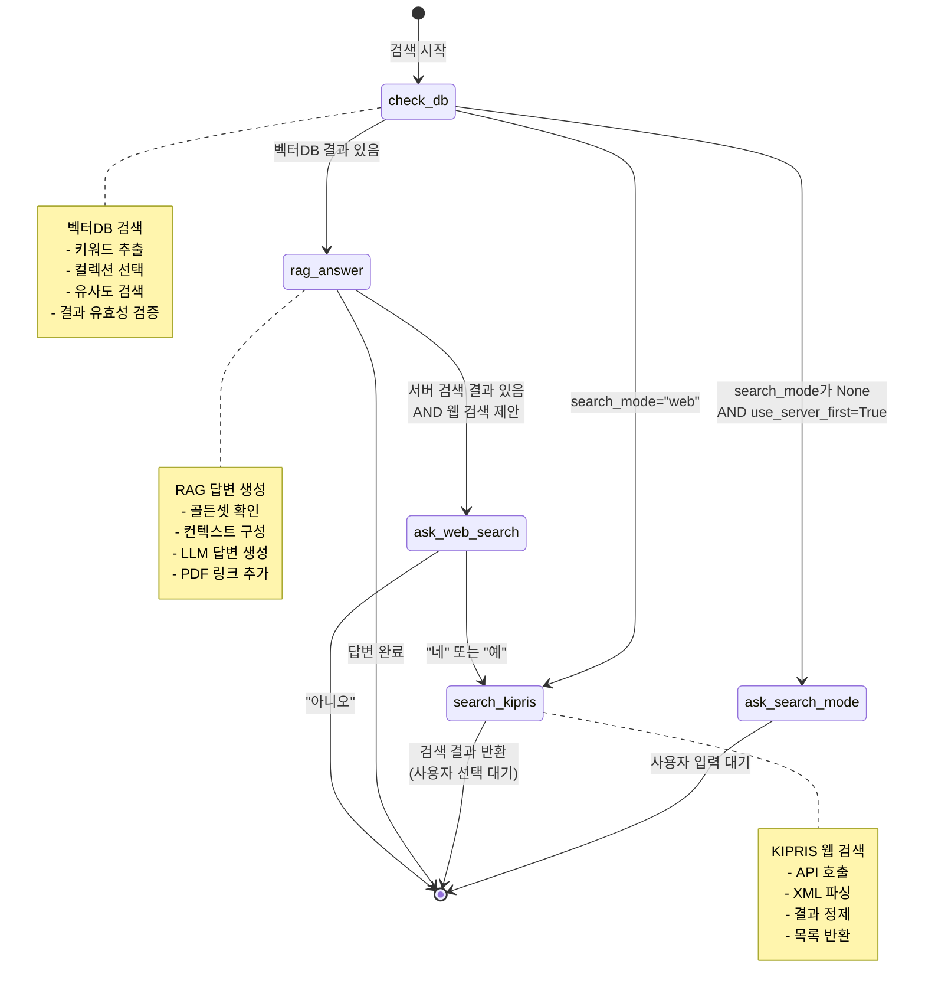
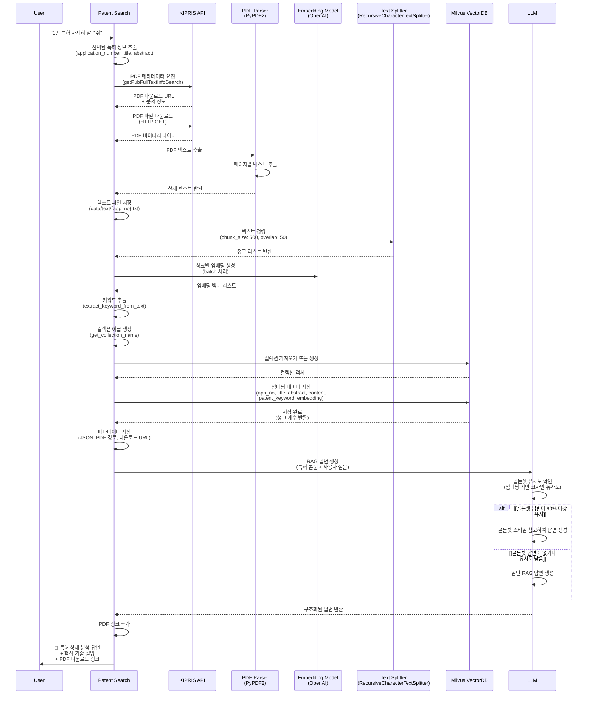
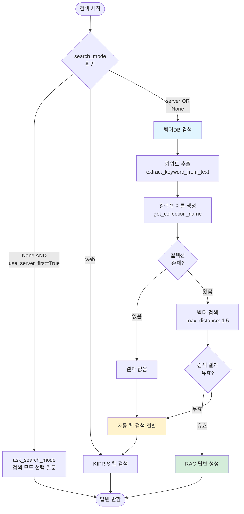
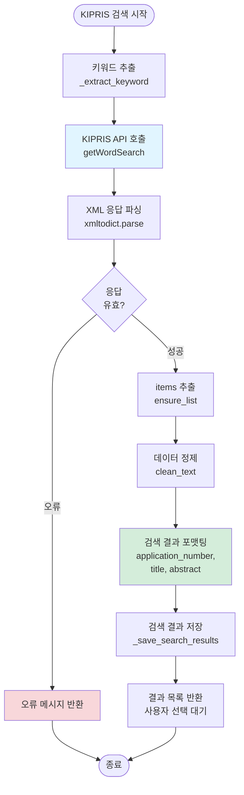
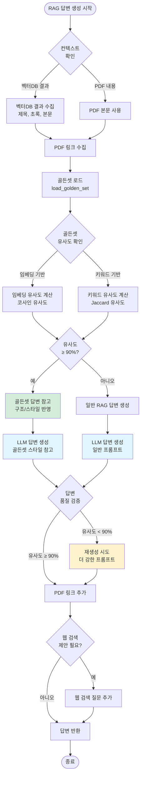

# 특허 검색 플로우 다이어그램

## 전체 특허 검색 플로우

```mermaid
sequenceDiagram
    participant User as User(직원)
    participant Orchestrator as Orchestrator<br/>(도메인 라우터)
    participant TechMaster as Tech Master<br/>(Intent 분류)
    participant PatentSearch as Patent Search<br/>(특허 검색 워크플로우)
    participant VectorDB as Vector DB<br/>(Milvus)
    participant KIPRIS as KIPRIS API
    participant LLM as LLM<br/>(답변 생성)

    %% ============================================
    %% 시나리오 1: 검색 모드 선택이 필요한 경우
    %% ============================================
    rect rgb(240, 248, 255)
    Note over User,LLM: 시나리오 1: 검색 모드 선택 질문
    
    User->>Orchestrator: "전기차 배터리 특허 찾아줘"
    
    Orchestrator->>Orchestrator: LLM 기반 도메인 분류<br/>(last_domain: None)
    Orchestrator->>Orchestrator: domain = "tech"
    
    Orchestrator->>TechMaster: tech 도메인으로 라우팅
    
    TechMaster->>TechMaster: LLM 기반 Intent 분류<br/>(previous_intent: None)
    TechMaster->>TechMaster: intent = "patent"
    
    TechMaster->>PatentSearch: search_patent 실행<br/>(keyword: "전기차 배터리")
    
    PatentSearch->>PatentSearch: 검색 모드 확인<br/>(search_mode: None)
    
    alt [검색 모드가 설정되지 않은 경우]
        PatentSearch->>User: ❓ 검색 방식을 선택해주세요:<br/>1. 서버 기반 검색 (빠르지만 제한적)<br/>2. 웹 검색 (느리지만 광범위)
        
        User->>PatentSearch: "1번" 또는 "서버"
        
        PatentSearch->>PatentSearch: search_mode = "server"
        PatentSearch->>VectorDB: 벡터DB에서 특허 검색<br/>(query: "전기차 배터리",<br/>limit: 5)
        
        VectorDB-->>PatentSearch: 검색 결과 반환<br/>(results: [...])
        
        alt [검색 결과가 있는 경우]
            PatentSearch->>LLM: RAG 답변 생성<br/>(특허 정보 + 사용자 질문)
            LLM-->>PatentSearch: 답변 생성 완료
            PatentSearch->>User: ✅ 답변 및 특허 정보<br/>+ 웹 검색 제안
        else [검색 결과가 없는 경우]
            PatentSearch->>PatentSearch: 자동으로 웹 검색 모드 전환
            PatentSearch->>KIPRIS: KIPRIS API 검색<br/>(keyword: "전기차 배터리",<br/>rows: 10)
            KIPRIS-->>PatentSearch: 특허 검색 결과 반환
            PatentSearch->>User: 🔍 검색 결과 목록 표시<br/>(사용자가 번호 선택 대기)
        end
    end
    end

    %% ============================================
    %% 시나리오 2: 서버 기반 검색 (벡터DB)
    %% ============================================
    rect rgb(248, 255, 248)
    Note over User,LLM: 시나리오 2: 서버 기반 검색 성공
    
    User->>PatentSearch: "디스플레이 특허 찾아줘"<br/>(search_mode: "server")
    
    PatentSearch->>PatentSearch: check_db_node 실행
    
    PatentSearch->>VectorDB: 벡터DB 검색<br/>(query: "디스플레이",<br/>max_distance: 1.5)
    
    VectorDB-->>PatentSearch: 검색 결과 반환<br/>(5개 특허, 유사도 점수)
    
    PatentSearch->>PatentSearch: 검색 결과 유효성 검증<br/>(거리, 관련성 확인)
    
    alt [검색 결과가 유효한 경우]
        PatentSearch->>LLM: RAG 답변 생성<br/>(특허 정보 + 사용자 질문)
        
        LLM->>LLM: 골든셋 유사도 확인<br/>(임베딩 기반)
        
        alt [골든셋 답변이 있는 경우]
            LLM->>LLM: 골든셋 스타일 참고하여 답변 생성
        else [골든셋 답변이 없는 경우]
            LLM->>LLM: 일반 RAG 답변 생성
        end
        
        LLM-->>PatentSearch: 구조화된 답변 반환
        
        PatentSearch->>PatentSearch: PDF 링크 수집 및 추가
        
        PatentSearch->>User: ✅ 특허 분석 답변<br/>+ PDF 링크<br/>+ 웹 검색 제안
    else [검색 결과가 부족한 경우]
        PatentSearch->>PatentSearch: 웹 검색 모드로 자동 전환
        PatentSearch->>KIPRIS: KIPRIS API 검색
        KIPRIS-->>PatentSearch: 검색 결과 반환
        PatentSearch->>User: 🔍 검색 결과 목록 표시
    end
    end

    %% ============================================
    %% 시나리오 3: 웹 검색 (KIPRIS API)
    %% ============================================
    rect rgb(255, 248, 240)
    Note over User,VectorDB: 시나리오 3: 웹 검색 및 상세 보기
    
    User->>PatentSearch: "반도체 특허 찾아줘"<br/>(search_mode: "web")
    
    PatentSearch->>PatentSearch: check_db_node 실행
    PatentSearch->>PatentSearch: 웹 검색 모드로 전환
    
    PatentSearch->>KIPRIS: KIPRIS API 검색<br/>(word: "반도체",<br/>rows: 10)
    
    KIPRIS-->>PatentSearch: XML 응답 반환<br/>(특허 목록)
    
    PatentSearch->>PatentSearch: XML 파싱 및 정제<br/>(application_number, title, abstract)
    
    PatentSearch->>User: 🔍 특허 검색 결과<br/>(1. [번호] 제목<br/>2. [번호] 제목<br/>...)
    
    User->>PatentSearch: "1번 자세히 알려줘"
    
    PatentSearch->>PatentSearch: 선택된 특허 정보 추출<br/>(application_number)
    
    PatentSearch->>KIPRIS: PDF 메타데이터 요청<br/>(application_number)
    KIPRIS-->>PatentSearch: PDF 다운로드 URL 반환
    
    PatentSearch->>KIPRIS: PDF 파일 다운로드
    KIPRIS-->>PatentSearch: PDF 파일 반환
    
    PatentSearch->>PatentSearch: PDF 텍스트 추출<br/>(PyPDF2)
    
    PatentSearch->>PatentSearch: 텍스트 청킹<br/>(RecursiveCharacterTextSplitter)
    
    PatentSearch->>PatentSearch: 임베딩 생성<br/>(OpenAI Embedding)
    
    PatentSearch->>VectorDB: 벡터DB에 저장<br/>(청크별 임베딩 + 메타데이터)
    
    VectorDB-->>PatentSearch: 저장 완료
    
    PatentSearch->>LLM: RAG 답변 생성<br/>(특허 본문 + 사용자 질문)
    
    LLM-->>PatentSearch: 상세 분석 답변 반환
    
    PatentSearch->>User: 📄 특허 상세 분석<br/>+ PDF 링크<br/>+ 핵심 기술 설명
    end

    %% ============================================
    %% 시나리오 4: 웹 검색 추가 요청
    %% ============================================
    rect rgb(255, 240, 245)
    Note over User,LLM: 시나리오 4: 서버 검색 후 웹 검색 추가
    
    User->>PatentSearch: 서버 검색 완료 후<br/>"웹에서도 찾아줘"
    
    PatentSearch->>PatentSearch: 웹 검색 여부 확인<br/>(_WAITING_FOR_WEB_SEARCH)
    
    PatentSearch->>KIPRIS: KIPRIS API 검색<br/>(원본 검색어 사용)
    
    KIPRIS-->>PatentSearch: 추가 특허 검색 결과
    
    PatentSearch->>User: 🔍 웹 검색 결과 목록<br/>(서버 결과와 병합)
    
    User->>PatentSearch: "1, 3, 5번 자세히"
    
    loop 여러 특허 처리
        PatentSearch->>KIPRIS: PDF 다운로드 및 처리
        PatentSearch->>VectorDB: 임베딩 저장
        PatentSearch->>LLM: RAG 답변 생성
    end
    
    PatentSearch->>User: 📋 선택한 특허들의<br/>상세 분석 결과
    end
```



---

## 특허 검색 워크플로우 내부 플로우



---

## 특허 상세 보기 플로우 (PDF 다운로드 및 임베딩)



---

## 주요 노드별 상세 플로우

### 1. check_db_node (벡터DB 검색)



### 2. search_kipris_node (KIPRIS 웹 검색)



### 3. download_pdf_node (PDF 다운로드 및 임베딩)

```mermaid
flowchart TD
    Start([PDF 다운로드 시작]) --> GetPatentInfo[특허 정보 추출<br/>application_number, title, abstract]
    
    GetPatentInfo --> RequestMeta[PDF 메타데이터 요청<br/>getPubFullTextInfoSearch]
    
    RequestMeta --> GetDownloadURL[PDF 다운로드 URL 추출]
    
    GetDownloadURL --> CheckURL{URL<br/>있음?}
    
    CheckURL -->|없음| Error1[오류: PDF URL 없음]
    CheckURL -->|있음| DownloadPDF[PDF 파일 다운로드<br/>HTTP GET, stream]
    
    DownloadPDF --> VerifyPDF{PDF 파일<br/>유효?}
    
    VerifyPDF -->|무효| Error2[오류: PDF 파일 형식 오류]
    VerifyPDF -->|유효| ExtractText[PDF 텍스트 추출<br/>PyPDF2]
    
    ExtractText --> CheckText{텍스트<br/>추출됨?}
    
    CheckText -->|없음| Error3[오류: 텍스트 추출 실패]
    CheckText -->|있음| SaveText[텍스트 파일 저장<br/>data/text/{app_no}.txt]
    
    SaveText --> ChunkText[텍스트 청킹<br/>RecursiveCharacterTextSplitter]
    
    ChunkText --> GenerateEmbedding[임베딩 생성<br/>OpenAI Embedding]
    
    GenerateEmbedding --> ExtractKeyword2[키워드 추출<br/>특허 제목/초록에서]
    
    ExtractKeyword2 --> GetCollectionName[컬렉션 이름 생성<br/>get_collection_name]
    
    GetCollectionName --> GetOrCreateCollection[컬렉션 가져오기 또는 생성<br/>get_or_create_collection]
    
    GetOrCreateCollection --> StoreEmbedding[임베딩 벡터DB 저장<br/>embed_and_store_patent]
    
    StoreEmbedding --> SaveMetadata[메타데이터 저장<br/>JSON: PDF 경로, URL]
    
    SaveMetadata --> Success[저장 완료]
    
    Error1 --> End([종료])
    Error2 --> End
    Error3 --> End
    Success --> RAGAnswer[RAG 답변 생성]
    RAGAnswer --> End
    
    style DownloadPDF fill:#e1f5ff
    style StoreEmbedding fill:#d4edda
    style Error1 fill:#f8d7da
    style Error2 fill:#f8d7da
    style Error3 fill:#f8d7da
```

### 4. rag_answer_node (RAG 답변 생성)



---

## 주요 함수 및 데이터 구조

### 검색 모드 처리

- **검색 모드 선택 질문**: `ask_search_mode_node`
  - 사용자가 검색 방식을 선택하지 않은 경우 질문
  - "1. 서버 기반 검색" 또는 "2. 웹 검색"

- **검색 모드 파싱**: `parse_search_mode_from_input`
  - 사용자 입력에서 검색 모드 자동 인식
  - 숫자 선택 ("1", "2") 또는 키워드 ("서버", "웹")

### 벡터DB 관련

- **컬렉션 관리**: `get_or_create_collection`
  - 키워드별 컬렉션 생성/조회
  - 한글 키워드를 영문 컬렉션 이름으로 변환

- **임베딩 저장**: `embed_and_store_patent`
  - 특허 텍스트를 청킹하고 임베딩 생성
  - 벡터DB에 저장 (patent_keyword 필터링 지원)

### PDF 처리

- **PDF 다운로드**: `kipris_download_pdf`
  - KIPRIS API에서 PDF 메타데이터 조회
  - PDF 파일 다운로드 및 저장

- **텍스트 추출**: `extract_pdf_text`
  - PyPDF2를 사용하여 PDF에서 텍스트 추출

### 답변 생성

- **RAG 답변**: `rag_answer_node`
  - 벡터DB 결과 또는 PDF 본문을 컨텍스트로 사용
  - 골든셋 유사도 확인 및 스타일 참고
  - LLM을 통한 구조화된 답변 생성

---

## 상태 관리 및 세션

### Redis 숏텀 메모리 (OrchestratorState.tech_search_context)

```python
{
    "tech_search_context": {
        "patent": {
            "intent": "search" | "ask_search_mode" | "ask_web_search",
            "query": "원본 사용자 쿼리",
            "last_keyword": "추출된 키워드",
            "results": [...],  # 검색 결과 목록
        }
    }
}
```

### 로컬 세션 상태

- `_WAITING_FOR_SEARCH_MODE`: 검색 모드 선택 대기
- `_WAITING_FOR_WEB_SEARCH`: 웹 검색 여부 대기
- `_SESSION_SEARCH_MODE`: 세션별 검색 모드 저장
- `_PENDING_SEARCH_KEYWORD`: 검색 모드 선택 대기 중인 검색어
- `_ORIGINAL_SEARCH_KEYWORD`: 웹 검색용 원본 검색어

---

## 에러 처리

1. **벡터DB 검색 실패**: 자동으로 웹 검색 모드로 전환
2. **KIPRIS API 오류**: 오류 메시지 반환 및 재시도 안내
3. **PDF 다운로드 실패**: 기본 정보(제목, 초록)만 반환
4. **텍스트 추출 실패**: 오류 메시지와 함께 PDF 링크 제공
5. **임베딩 저장 실패**: 경고 로그만 출력하고 계속 진행

